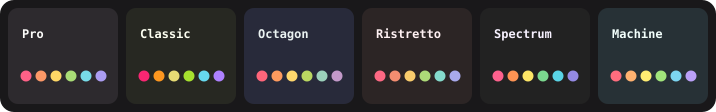

<div align="center">


# Monokai Pro for DSH

**A dark UI/UX theme for the DeepSeek Harness Web GUI, ported from [Monokai Pro](https://monokai.pro/).**

Official palette values from the Monokai Pro VS Code extension (2.0.16) — not approximated.
Delivered as a Cordis bundle with a Client half, so it survives restarts and applies to the running page.

[](LICENSE)
[](package.json)
[](https://www.npmjs.com/package/dsh-monokai-pro)
[](#highlights)

</div>

---

## Highlights

<p align="center"></p>

- **Six official filters** — Monokai Pro, Classic, Octagon, Ristretto, Spectrum and Machine, selectable as swatches in the settings row (dark scheme only, exactly like the real product).
- **Warm charcoal surfaces** — `#2D2A2E` workspace, `#221F22` sidebar/status/title, `#19181A` deepest chrome, `#403E41` widgets, panels, menus and inputs. Every filter maps its own `background`/`dark1`/`dark2`/`dimmed5` roles onto these.
- **Monokai text ladder** — `#FCFCFA` primary, `#C1C0C0` secondary, `#939293` tertiary, `#727072` captions, `#5B595C` dimmed, each taken from the active filter.
- **Six-color accent family** — yellow `#FFD866` brand and primary action, pink `#FF6188` errors, orange `#FC9867` warnings, green `#A9DC76` success, cyan `#78DCE8` info, purple `#AB9DF2` constants.
- **Monokai syntax highlighting** — pink keywords, yellow strings, green functions, purple constants, orange parameters and grey comments.
- **Complete chrome** — yellow accent wash for active and hover states, themed focus rings, scrollbars, toasts, tooltips and diffs.
- **Code-first typography** — Avenir Next → Inter → Segoe UI Variable Text in the UI, JetBrains Mono → Cascadia Code → Fira Code → SF Mono in code. A user font chosen in **Settings → General → Font settings** still wins.
- **Light mode included** — the official Monokai Pro Light counterpart (`#FAF4F2` canvas, `#EDE7E5` sidebar, `#29242A` text), so switching Appearance to Light never leaves half-themed surfaces. Filters apply to dark only.

## What is DSH?

DeepSeek Harness (DSH) boots a profile — an ordered stack of plugin-bundle patch layers on top of a DeepSeek app (web GUI, TUI, headless…). This package is one of those plugin bundles: it carries no Host code, only a Client half that injects the theme into the Web GUI.

## Installation

**Requirements**

- A working DSH install (`dsh` on your `PATH`) with a profile that includes the Web GUI, e.g. `web`.
- No build step and no peer dependencies — `client.js` ships as written.

**From npm (recommended)**

```sh
dsh plugin --profile <name> add dsh-monokai-pro
```

For the default Web GUI profile that is:

```sh
dsh plugin --profile web add dsh-monokai-pro
```

The package is `dsh-monokai-pro` on the [npm registry](https://www.npmjs.com/package/dsh-monokai-pro); `dsh plugin … add` delegates to pnpm, so `npm`/`pnpm` dist-tags and version ranges work the same way.

**From GitHub**

The npm package and this repository are published in lockstep — installing from npm is always the easier path. To hack on the theme instead, clone the repo and install it from the local directory:

```sh
git clone https://github.com/trespassmk/dsh-monokai-pro.git
dsh plugin --profile web add ./dsh-monokai-pro
```

**After installing**

1. Reload the Web page once after installing or updating the bundle, so the browser loads the current `client.js` generation.
2. Open **Settings → General** — the **Monokai Pro** row sits after Transcript view.
3. The switch is on by default on first install, and that first activation also sets the appearance preference to **Dark**. Turning the switch off removes the token layer immediately and leaves the built-in palette in place.
4. Pick a filter with the swatches under the description: each dot previews the variant's canvas (lower-left half) and its pink accent (upper-right half).

**Updating & removal**

```sh
dsh plugin --profile web add dsh-monokai-pro@latest   # update
dsh plugin --profile web remove dsh-monokai-pro       # remove
```

> The switch state and the filter choice are browser-local (`localStorage`, keys `dsh.plugin.monokai-pro.enabled` and `dsh.plugin.monokai-pro.variant`). The theme service persists only the built-in `light` / `dark` / `system` preference, so a third-party layer cannot store its own id in the Host settings document — the palette itself always reapplies on reload.

## How it works

- `client.js` calls `ctx.theme.overrideTokens(packageId, tokens)` — a stacked alias-token layer over whatever built-in theme is active. Removing the layer restores exactly the tokens it covered; the base palette is never edited.
- `buildTokens(palette)` derives the whole layer from one filter's palette object, so adding a variant is adding twelve hex values, not touching the token map.
- Every value is supplied as a `{ light, dark }` pair, as the theme service requires.
- The row is contributed to the `settings.general.item` slot and uses only `--dsw-alias-*` tokens plus `role="switch"` / `aria-checked` / `aria-pressed` semantics.
- `index.js` is an empty Host half; the bundle exists so the profile can carry the Client row and the plugin stays visible in the plugin inventory.

<details>
<summary><strong>Palette reference</strong></summary>

The Pro filter below is reverse-engineered from the official Monokai Pro VS
Code extension (`theme-monokai-pro-vscode` 2.0.16, `themes/Monokai Pro.json`
and `Monokai Pro Light.json`, kept in this repo as
`Monokai Pro-reference.json`). The other five filters are transcribed from the
official palettes as mirrored by `monokai-pro.nvim`
(`lua/monokai-pro/palette/*.lua`), whose Pro and Light entries match the
extension JSON value-for-value. Every value used by the token layer traces to
one of these hexes or to an alpha step the reference itself uses — no invented
colors remain in the dark scheme.

| Role               | Pro dark  | Light                      |
| ------------------ | --------- | -------------------------- |
| Background deepest | `#19181A` | `#E0DAD9` (activity)       |
| Background deep    | `#221F22` | `#EDE7E5` (sidebar/status) |
| Background         | `#2D2A2E` | `#FAF4F2`                  |
| Surface            | `#403E41` | `#FEFAF9`                  |
| Border             | `#5B595C` | `#D3CDCC`                  |
| Focus              | `#727072` | `#A59FA0`                  |
| Text soft          | `#C1C0C0` | `#706B6E`                  |
| Text subtle        | `#939293` | `#918C8E`                  |
| Text dimmed        | `#727072` | `#BFB9BA`                  |
| Foreground         | `#FCFCFA` | `#29242A`                  |
| Pink               | `#FF6188` | `#E14775`                  |
| Orange             | `#FC9867` | `#E16032`                  |
| Yellow             | `#FFD866` | `#CC7A0A`                  |
| Green              | `#A9DC76` | `#269D69`                  |
| Cyan               | `#78DCE8` | `#1C8CA8`                  |
| Purple             | `#AB9DF2` | `#7058BE`                  |

Detail washes follow the reference's own alpha steps rather than round-number
approximations: diff lines and gutters use the accent at `19` alpha, hover and
line-highlight washes `0C`, selections and scrollbar thumbs `26`, the active
scrollbar `59`, and drop targets `deep + BF` (`#221F22BF`).

</details>

<details>
<summary><strong>Files</strong></summary>

```
package.json              bundle manifest, client export, locale and icon exports
cordis.patch.yml          inserts the monokai-pro row
index.js                  empty Host half
client.js                 filter palettes, token layer, settings row, row styles
locale/en.json            plugin inventory metadata (English)
locale/zh.json            plugin inventory metadata (Chinese)
icon.svg                  original mark: Monokai "M" over the six-color palette
docs/filters.svg          README preview of the six filter palettes
Monokai Pro-reference.json  official extension theme JSON used as color reference
```

</details>

## License

[MIT](LICENSE)
